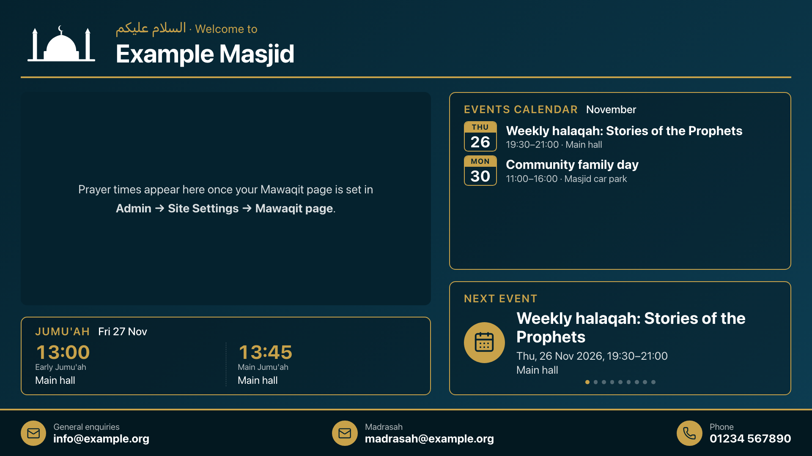
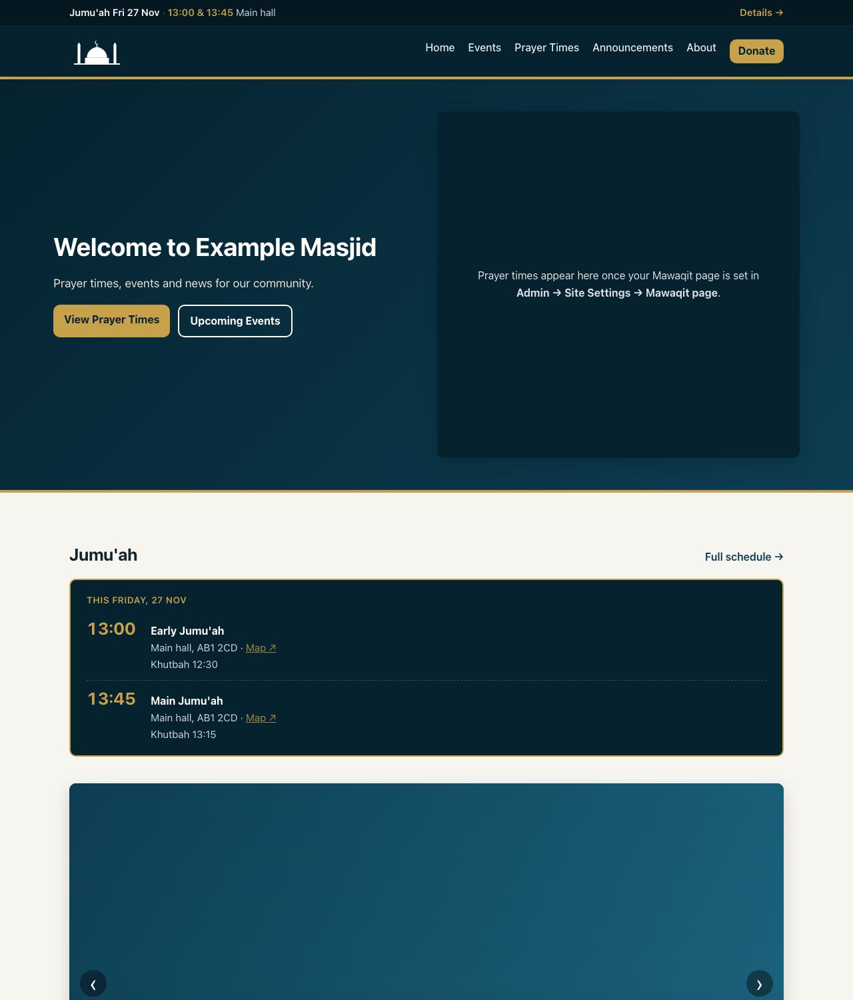
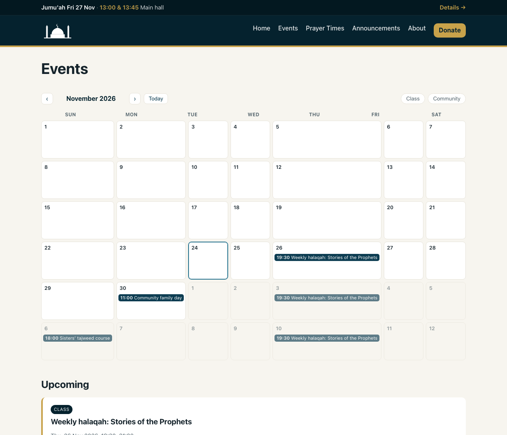

# Masjid Website Kit

A ready-to-run website, entrance-TV screen and admin panel for a masjid, built
with [Payload CMS](https://payloadcms.com) and [Next.js](https://nextjs.org).
The committee runs it from an easy admin panel, or simply by asking Claude
("add the Eid prayer on Friday at 8am"), through the built-in MCP connector.



## What you get

- **Website**: homepage, prayer times, Jumu'ah, an events calendar, announcements, About, Madrasah and Donate pages.
- **Prayer times from [Mawaqit](https://mawaqit.net)**: enter your mosque's Mawaqit page once and the times stay up to date.
- **Jumu'ah sessions**: any number of sessions and venues, shown in a bar on every page, on the homepage and on the TV.
- **Events**: one-off, weekly and monthly events, a month calendar, posters, and draft or cancelled states.
- **Entrance TV screen** at `/tv`: prayer times, Jumu'ah, this month's events, a slideshow of your services and your contact details. It fits any 16:9 screen, reloads itself every 10 minutes and isn't linked from the site.
- **Admin panel** at `/admin`: administrator and committee-editor roles, with two-factor login enforced for everyone.
- **MCP endpoint** at `/api/mcp`: manage events, Jumu'ah, pages and settings from Claude (web, desktop or phone) or any MCP client. Each key acts as a named user and can only do what you switch on. See [docs/MCP.md](docs/MCP.md).
- **Image uploads from Claude**: attach a poster from a web link, or get a one-time link to upload a photo from your phone.
- **Public REST API** for prayer and event data, for bots, displays or other websites. See [docs/API.md](docs/API.md).
- **Deployment templates** for a small Linux server: nginx, systemd, automatic deploys on every push, and backups. See [docs/DEPLOY.md](docs/DEPLOY.md).

| Homepage | Events |
| --- | --- |
|  |  |

## Quick start (on your computer)

You need [Node.js](https://nodejs.org) 20 or newer and [pnpm](https://pnpm.io) 10 (`corepack enable` gives you pnpm).

```bash
git clone https://github.com/durakkerem/masjid-website-kit.git
cd masjid-website-kit
cp .env.example .env               # then set PAYLOAD_SECRET (see the file)
pnpm install
pnpm payload migrate               # creates the database (masjid.db)
pnpm seed                          # optional: example content
pnpm dev
```

Open http://localhost:3000. Then go to http://localhost:3000/admin and create the first account: it becomes the
administrator. You'll be asked to set up an authenticator app (Google Authenticator, Microsoft Authenticator, 1Password…).

## Make it yours

Everything below is in the admin panel; you don't need to touch any code.

1. **Site Settings → General**: masjid name, short name, tagline, address, phone, email.
2. **Site Settings → General → Mawaqit page**: the last part of your mosque's mawaqit.net address
   (for `https://mawaqit.net/en/my-masjid-city`, enter `my-masjid-city`). Your prayer times appear everywhere.
3. **Jumu'ah Times**: one row per session (time, label, venue, postcode), plus an optional note for special arrangements.
4. **Site Settings → Donate page**: online donation links, bank details and charity number.
5. **Site Settings → Entrance TV**: contact details for the bottom strip and the services for the slideshow.
6. **Madrasah Page**: fill in the introduction and the page (and its menu link) appears.
7. **Pages → About**, **Events** and **Announcements**: your content.

In the code:

- Replace `public/logo.svg` with your logo (any single colour; the site shows it in white) and `src/app/icon.svg` with your browser icon.
- Colours live at the top of `src/app/(frontend)/styles.css` (`--green-900`, `--gold-500`, …).
- Set your timezone in `.env` with `NEXT_PUBLIC_SITE_TIMEZONE`, e.g. `Europe/London`, `America/Toronto` or `Asia/Karachi`.

## The entrance TV

Open `https://your-site/tv` in full screen on any TV with a browser: a smart TV, a Fire TV stick or a mini PC. It needs no
log-in and no buttons, and it reloads itself every 10 minutes, so changes made in the admin panel (or through Claude)
show up without anyone touching the screen. The events calendar shows this month's events; if nothing is on, the
services slideshow takes its place.

## Running it for real

[docs/DEPLOY.md](docs/DEPLOY.md) walks through hosting on a small virtual server (about £4–6 a month at Hetzner,
DigitalOcean and similar): domain, HTTPS, the service, automatic deploys from GitHub, and backups
([docs/BACKUPS.md](docs/BACKUPS.md)). The database is a single SQLite file, which is plenty for a masjid website and easy to back up.

## Working on the code

```bash
pnpm dev          # local site with hot reload
pnpm typecheck    # TypeScript
pnpm test         # unit tests (dates, recurring events, Jumu'ah, image safety)
pnpm payload migrate:create my-change   # after changing collections or fields…
pnpm payload migrate                    # …then apply it (deploys run this for you)
```

Content types live in `src/collections` and `src/globals`; pages in `src/app`; the MCP setup in `src/payload.config.ts`
and `src/mcp`. Pull requests are welcome: see [CONTRIBUTING.md](CONTRIBUTING.md).

## Credits and licence

Originally built for Bracknell Islamic Cultural Society in the UK and shared so other masajid can benefit. Released
under the [MIT licence](LICENSE): use it, change it and host it freely.
